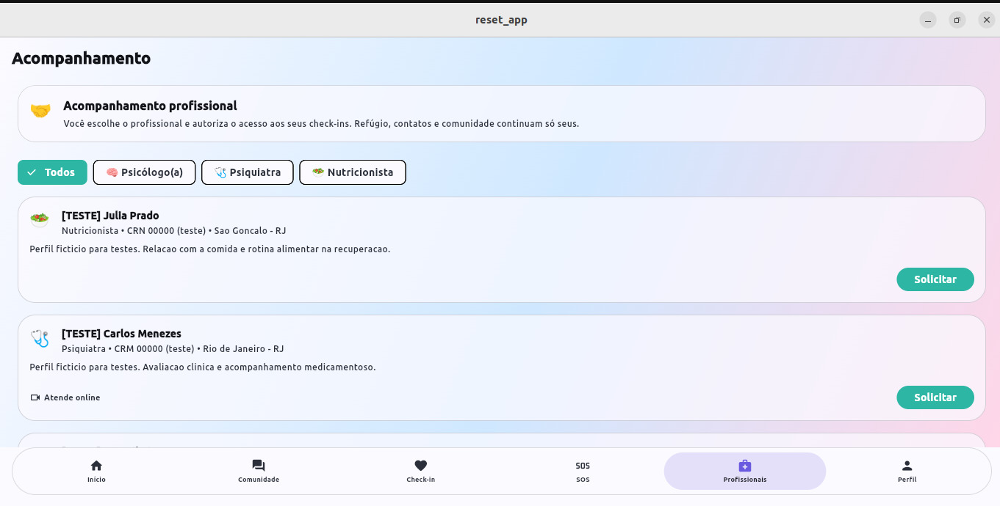
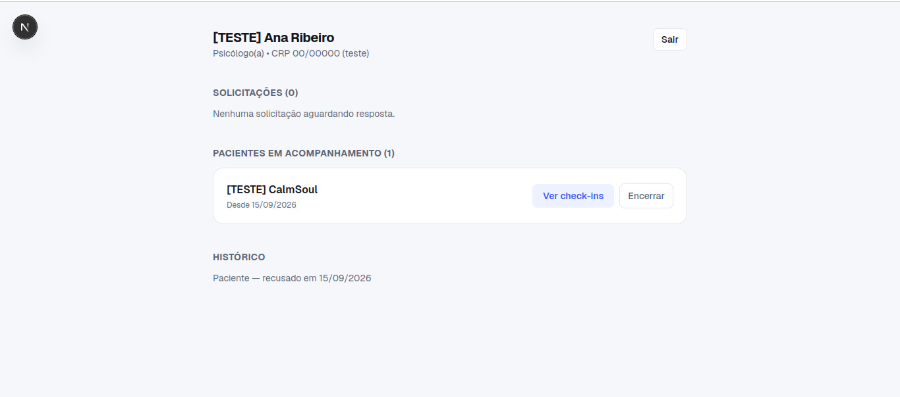
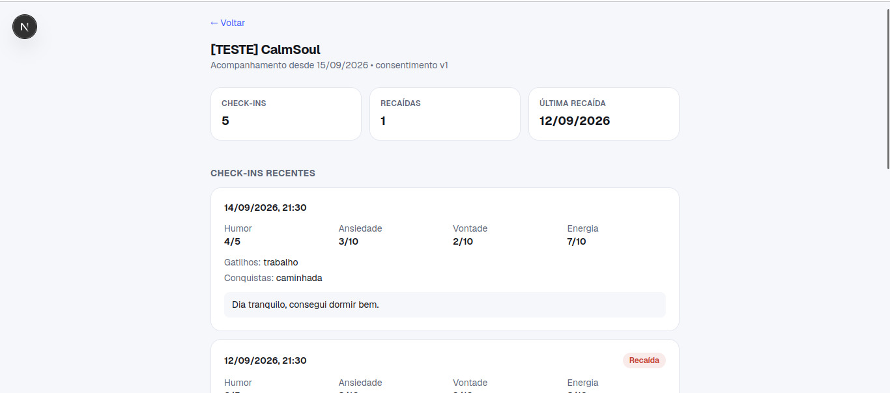
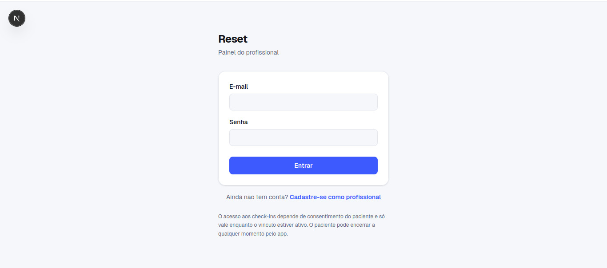
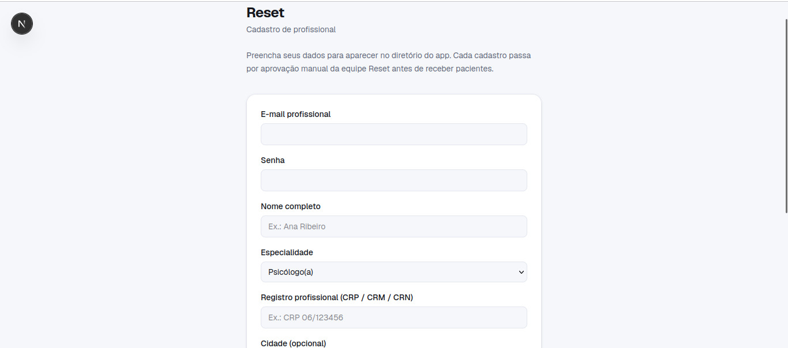
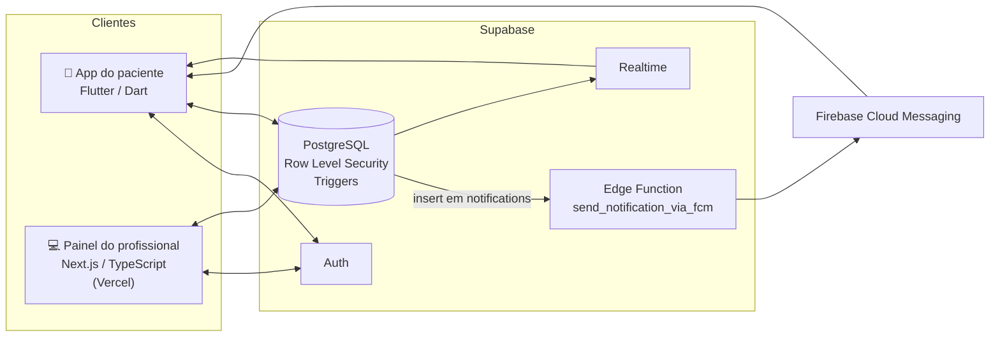

# Reset

**Plataforma de apoio à recuperação de compulsões, com acompanhamento profissional baseado em consentimento.**

O Reset é formado por um **app para pacientes** (Flutter) e um **painel web para profissionais de saúde** (Next.js), sobre um back-end **Supabase**. O paciente registra check-ins diários, participa de uma comunidade moderada, tem acesso a uma área de SOS e pode escolher um psicólogo, psiquiatra ou nutricionista para acompanhá-lo. O profissional só vê os check-ins que o paciente autorizou, e só enquanto o vínculo estiver ativo.

> 🤖 Desenvolvido com o Claude (Anthropic) como assistente de código. Arquitetura, decisões de produto e validação foram minhas.

> 🔒 O código-fonte é privado. Este repositório apresenta o projeto: arquitetura, decisões técnicas e telas.
> Todas as telas abaixo usam **dados fictícios de teste**.

**Painel do profissional (em produção):** https://rehab-app-bice.vercel.app

---

## Telas

### App do paciente — diretório de profissionais
Filtro por especialidade e solicitação de acompanhamento. Refúgio, contatos e comunidade continuam visíveis só para o paciente.

### Painel do profissional — pacientes em acompanhamento

### Painel do profissional — check-ins autorizados
Resumo (check-ins, recaídas, última recaída) e histórico com humor, ansiedade, vontade, energia, gatilhos e conquistas.

### Login e cadastro de profissionais
Todo cadastro passa por aprovação manual antes de o profissional aparecer no diretório.

| Login | Cadastro |
|---|---|
|  |  |

---

## Arquitetura

## Funcionalidades

- **Check-ins diários**: humor, ansiedade, vontade, energia, gatilhos e conquistas, com marcação de recaída.
- **Acompanhamento profissional por consentimento**: o paciente solicita, o profissional aceita ou recusa e o acesso aos dados vale só enquanto o vínculo existir. Qualquer um dos dois pode encerrar.
- **Agendamento multiprofissional**: horários de atendimento por profissional e validação de conflito de horários entre consultas.
- **Notificações bidirecionais**: confirmação, cancelamento, reagendamento e lembrete, geradas por triggers no banco e entregues em tempo real (Supabase Realtime) e por push (FCM).
- **Comunidade moderada**: categorias por hábito e moderação por administrador.
- **SOS e Refúgio**: recursos de crise que ficam **só no dispositivo do paciente**, sem ir para o servidor.
- **Aprovação de profissionais**: o cadastro passa por revisão manual antes de aparecer no diretório.

## Decisões técnicas

- **Segurança no banco, não só na interface**: todas as tabelas sensíveis usam *Row Level Security*. O profissional só lê check-ins de pacientes com vínculo ativo e consentimento registrado.
- **Notificações orientadas a eventos**: triggers PostgreSQL inserem em `notifications`. Uma Edge Function chamada via `net.http_post` dispara o push no FCM, e o app atualiza a interface de forma otimista.
- **Privacidade desde o design (LGPD)**: dados de crise ficam locais e o profissional não manda texto livre ao paciente (só mensagens padronizadas), o que reduz risco de exposição e de abuso.
- **Testes end-to-end**: 19 cenários validados, como overlap de horários entre profissionais, fluxo de solicitação e aceite e os disparos de notificação.

## Stack

| Camada | Tecnologias |
|---|---|
| Mobile | Flutter, Dart |
| Web | Next.js, TypeScript, React — deploy na Vercel |
| Back-end | Supabase: PostgreSQL, Auth, Row Level Security, Realtime, Edge Functions |
| Notificações | Firebase Cloud Messaging |
| Ferramentas | Git, Linux (Ubuntu) |

## Status

Em fase de testes, preparando a abertura para os primeiros usuários. Próximos passos: modo offline (fila de check-ins sem internet) e publicação nas lojas.

---

**Autor:** João Vitor Carvalho Cecim — estudante de Ciência da Computação (UFF)
[LinkedIn](https://linkedin.com/in/joao-cecim) · [GitHub](https://github.com/Joaocecim)
